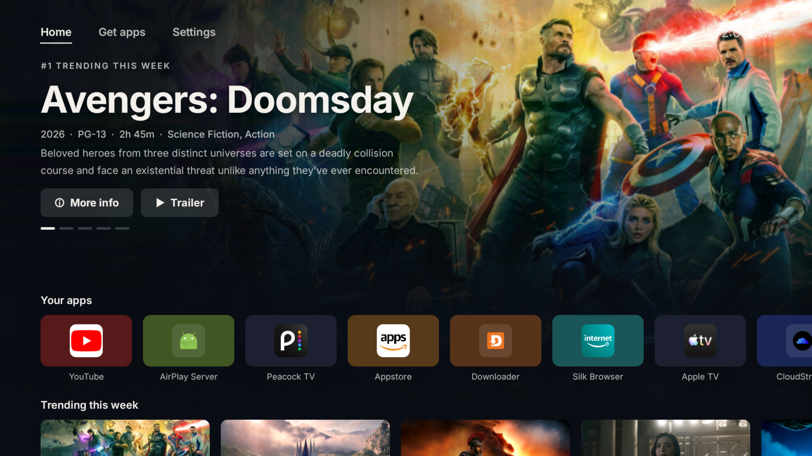
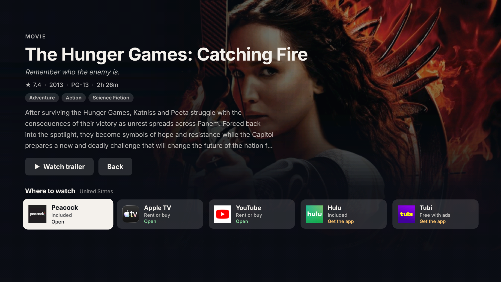

# customize-tv

Debloat and a custom home screen for a Toshiba Fire TV Edition, driven over ADB
from this Mac.

## The TV

| | |
|---|---|
| Model | `AFTKMST12` (Toshiba 4K UHD Fire TV Edition) |
| Codename | `keira` |
| Fire OS | 6.7.1.1, build `NS6711` |
| Android | 7.1.2, API 25 |
| Address | `10.0.0.71`, ADB on port 5555 |

Measured on the device, not taken from the spec sheet:

| | |
|---|---|
| Android draws at | 1920x1080, density 320dpi, so a 960x540dp canvas |
| Panel | 3840x2160. Android does **not** draw at 4K |
| RAM | 1.58 GB total, about 285 MB free in normal use |
| Per-app heap cap | 192 MB |
| CPU / ABI | 4 cores, `armeabi-v7a` only, 32-bit |
| GPU | Mali-T820 MP2, OpenGL ES 3.2 |
| Free storage | about 2.3 GB |

Give the TV a fixed address in your router. ADB is the recovery path if the home
screen ever breaks, so it must stay reachable.

Turn on ADB in `Settings` > `My Fire TV` > `About`, click `Build` seven times,
then `Developer Options` > `ADB debugging`.

The TV drops off the network in standby. Wake it before running anything here.

## Layout

- `atrium/` is the home screen, `dev.skhanal.atrium`. Original work.
  - [`atrium/DESIGN.md`](atrium/DESIGN.md) is what it looks like and why.
  - [`atrium/REDESIGN.md`](atrium/REDESIGN.md) is the history of the
    previous design, the generated "room". It is kept for what it found out
    about this TV.
  - [`atrium/TESTING.md`](atrium/TESTING.md) is what was measured on the TV,
    including what was not tested.
- `firetv/` is the work written for this TV.
  - `debloat.txt` is the package list, with a comment explaining every entry.
  - `debloat.sh` applies it. `restore.sh` undoes it.
  - `install-atrium.sh` builds and installs Atrium. `uninstall-atrium.sh`
    removes it.
  - `backup/` is the package and property state from before any change.
  - `shots/` holds before and after screenshots.
- `tools/` is a small ADB client in Python. It is used instead of the `adb`
  binary, which fails with "No route to host" on macOS because of Local Network
  privacy.

## What it looks like



The week's trending movies and shows fill the screen. Your apps sit in a row
under them, each on a plate of its own icon colour. Point the remote at a
title and its artwork fills the screen.



Select a title to see where you can watch it in the United States. Apps on
this TV say **Open**. Apps you do not have say **Get the app** and open their
Amazon Appstore page.

**Get apps**, in the top bar and at the end of your apps, lists popular apps
with a search field. The last card opens the Amazon Appstore for anything else.

**Settings > Genres** picks genres you like. A **Your genres** row then mixes
popular movies and shows in any of them. With no genres picked, the row is hidden.

Every screen, taken from the TV:

| File | Shows |
|---|---|
| `atrium-01-home.png` | Home. The hero shows the top five trending titles in turn |
| `atrium-02-trending.png` | A card in Trending this week focused. The hero follows it |
| `atrium-03-on-your-apps.png` | Titles included with the streaming apps on this TV |
| `atrium-04-popular-shows.png` | Popular shows, as posters |
| `atrium-05-detail.png` | The detail screen for one title |
| `atrium-06-where-to-watch.png` | Where to watch, with Peacock focused |
| `atrium-07-app-menu.png` | The menu on an app |
| `atrium-08-settings.png` | Settings |
| `atrium-09-get-apps.png` | Get apps: search, popular apps, and the full Appstore |
| `atrium-10-genres.png` | Settings > Genres. Select turns a genre on or off |

`firetv/shots/01-before-stock-home.png` is what the TV looked like before.

`firetv/shoot-atrium.sh` takes this set again. It drives the remote over ADB,
so only run it when nobody is watching the TV.

## Installing Atrium

First time setup for the build and the ADB client:

```sh
brew install openjdk@17 android-commandlinetools
sdkmanager "platforms;android-34" "build-tools;34.0.0"
python3 -m venv tools/venv && tools/venv/bin/pip install adb-shell rsa cryptography
```

Movie and show rows need a free TMDB account. Make one at themoviedb.org,
then go to `Settings` > `API` and copy the **API Read Access Token**. Put it
in `~/.gradle/gradle.properties`, never in this repository:

```
TMDB_READ_TOKEN=eyJhbGciOi...
```

The token is built into the APK, so anyone who copies the APK off the TV can
read it. A build without a token still works and shows apps only.

Then:

```sh
TV_HOST=10.0.0.71 firetv/install-atrium.sh
```

That builds and installs Atrium and grants `READ_LOGS`. It leaves Amazon's
launcher enabled.

Then turn on **Settings > Open Atrium on Home and wake**.

To remove Atrium:

```sh
TV_HOST=10.0.0.71 firetv/uninstall-atrium.sh
```

## What happens when you press Home

Fire OS still sends Home to Amazon's launcher. Atrium reads the short Home
press from the system log and opens over it. Long Home presses and Amazon
settings keep their normal behavior. **Settings > Fire TV home screen** opens
Amazon's home on purpose. It stays there until you press Home or leave it.

The normal Android launcher choice and accessibility watcher do not work on
this TV. Earlier notes concluded that no Home workaround was possible. That
conclusion was wrong. Atrium detects the Home press in the system log. It
waits for Amazon to finish opening, then moves its own task to the front.
This worked on the TV without a helper or a Mac running after reboot.
Fire OS delivered the boot event about a minute after the restart, then Atrium
opened itself.

Atrium still needs `READ_LOGS`, granted once during installation. It follows
only `ContextImpl` warnings in the system buffer and matches the short Home
press method name. It does not save or send log data. The first Home press
may take longer if Atrium has never opened and has no task to move.

Turn the preference off to stop both the Home and wake watchers. Amazon's
launcher remains available.

See [the test report](atrium/TESTING.md#home-button-update-22-october-2026)
for measured results and limits.

## What works, what does not

### Works, and was tested on the TV

- Rows of trending movies, titles on your streaming apps, and popular shows,
  with artwork, from TMDB.
- A Your genres row, from genres picked in Settings. Movies and shows take turns.
- A detail screen for each title, with where to watch it in the United States.
- **Open** starts an installed app: Peacock, Apple TV and YouTube were opened
  from the detail screen.
- **Get the app** opens the app's Amazon Appstore page. Every package name
  Atrium uses was checked on the TV.
- **Watch trailer** plays the trailer in YouTube.
- **Get apps**: typing with the TV keyboard filters the apps, an app you do not
  have opens its Appstore page, and the last card opens the Appstore home.
- Finding and opening every installed app.
- Moving an app along the row, hiding apps, and bringing them back. Hold
  Select on an app, or press Menu, for its menu.
- Handing off to Fire TV settings: Network, and System (the My Fire TV screen).
- Focus restored when you come back from an app.
- With the network unplugged, the last rows are shown from the TV's own copy.

Measured on the device: **3.2% janky frames** while moving fast along the
rows (42 of 1,303), a 5ms median frame against a 16.7ms budget, **87 MB** of
memory, and a **490 to 609ms** cold start. The APK is **317 KB**. Details and
method are in [`atrium/TESTING.md`](atrium/TESTING.md).

A few things were not tested, and they are listed in that file.

### Cannot be done on this TV

These were tested on the device and refused. They are not offered in the UI.

| Wanted | Why not |
|---|---|
| Switch to HDMI 1/2/3 or Composite | `com.amazon.tv.inputpreference.permission.LAUNCH_INPUTS` and `com.amazon.tv.permission.TUNE_INPUT` are both `signature\|amazon`. Even ADB shell is denied |
| Replace the system Home handler | Protected by Fire OS. Atrium follows Home presses instead. See above |
| Open a title inside Peacock or Apple TV | TMDB does not give those apps' own title IDs, and Peacock accepts no links. **Open** starts the app at its home screen |
| Open Prime Video | Prime Video closes again as soon as another app opens it. It is left out of Where to watch |
| Search the Appstore from inside Atrium | The Appstore search link opens the Amazon home screen on Fire OS 6. Atrium searches its own list of apps, and opens the Appstore home, which has Search, for the rest |
| Continue watching from Netflix, Prime Video and so on | No legitimate API gives a third-party launcher that history |
| Date and Bluetooth settings screens | Those intents do not resolve on Fire OS 6 |
| Display and Sound, Accessibility, Preferences, My Account | All guarded by `com.amazon.tv.permission.LAUNCHER_SETTINGS`, which is `signature\|amazon` |
| A top-level Settings button | `android.settings.SETTINGS` has two handlers, one a compliance stub. Firing it lands on the Amazon home screen, which is the one place a replacement home screen must not send you |
| An Applications button | The screen opens and then closes itself within milliseconds when opened on its own. It does stay open when given a package, which is what App info in the app menu does |

The TV input framework does expose HDMI 1, HDMI 2, HDMI 3 and Composite, and
reports them as disconnected when nothing is plugged in. Reading that is
allowed. Switching to them is not.

### Deliberately not included

- No adverts and no sponsored rows.
- No account and no sign-in.
- No tracking.
- No location permission. Network state is used for the offline notice.
- Boot access restarts the watchers. Log access detects Home presses.
- Internet access is used for TMDB only: `api.themoviedb.org` for titles and
  where to watch, and `image.tmdb.org` for artwork. Nothing about the TV or
  the person using it is sent. The last rows are saved on the TV, so the home
  screen still has them when the network is down.

## The debloat

```sh
TV_HOST=10.0.0.71 firetv/debloat.sh   # apply
TV_HOST=10.0.0.71 firetv/restore.sh   # put the TV back to stock
```

38 packages disabled. Ads, telemetry, demo tools, and unused Amazon apps.
Live TV and channel scanning stay enabled so the TV button can open normal
channels.

8 packages are protected and cannot be disabled, including the OTA updater. A
firmware update can undo the debloat. Blocking `softwareupdates.amazon.com` at
the router is the only durable fix.

## Reading the TV without changing it

```sh
TV_HOST=10.0.0.71 tools/venv/bin/python -I tools/tv.py --probe
TV_HOST=10.0.0.71 tools/venv/bin/python -I tools/tv.py 'pm list packages'
```

Screenshots work and come back at 3840x2160:

```sh
TV_HOST=10.0.0.71 tools/venv/bin/python -I tools/tv.py 'screencap -p /sdcard/s.png'
TV_HOST=10.0.0.71 tools/venv/bin/python -I tools/tv.py --pull /sdcard/s.png shot.png
```

An earlier note in this file said `screencap` returns an all black image on this
device. That is wrong. It works.

## Credit

`tools/`, the small ADB client, comes from
[tv-vibehack](https://github.com/Gathin23/tv-vibehack) by Gathin23, used under
the MIT licence in `LICENSE`.

Movie and show data and artwork come from [TMDB](https://www.themoviedb.org).
This product uses the TMDB API but is not endorsed or certified by TMDB.
Where-to-watch data is provided to TMDB by JustWatch.

`atrium/` is original and shares no code with that project. It uses the Jost
typeface under the SIL Open Font Licence, in
`atrium/FONT-LICENSE-OFL-Jost.txt`.

An earlier home screen adapted from that project used to live in `launcher/`.
It has been removed. Atrium replaces it.
